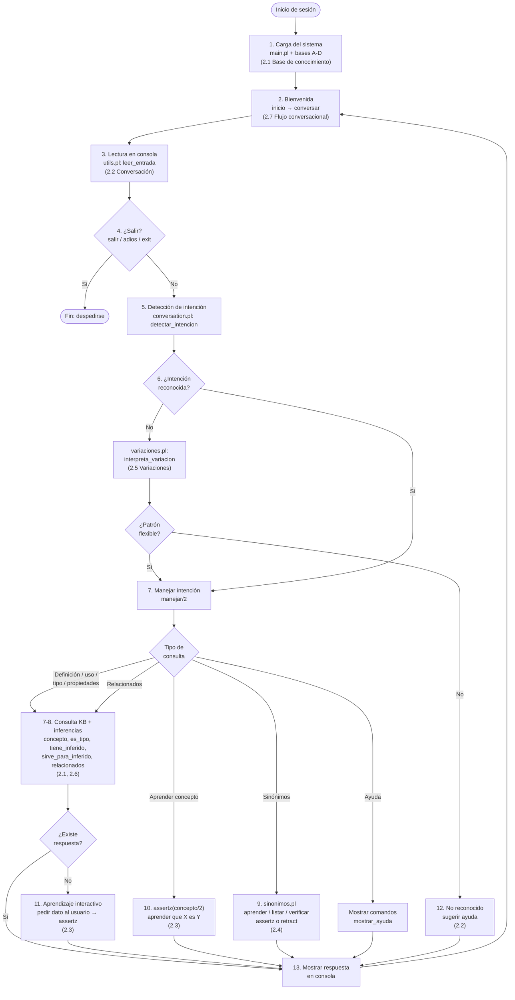

# ChatBotProlog Inteligente con Programación Lógica
 
El Chatbot Inteligente es una aplicación de consola desarrollada en Prolog que permite a los usuarios mantener conversaciones interactivas, hacer preguntas sobre una base de conocimiento, aprender nueva información dinámicamente y explorar inferencias lógicas. El sistema funciona como una herramienta de diálogo que responde preguntas, maneja sinónimos y genera nuevo conocimiento durante la ejecución.
 
---
 
## Integrantes
 
- Christopher Daniel Vargas Villalta, 2024108443
- Andrey Jesús Jiménez Núñez,  2024145153
- Isaac Villalobos Bonilla, 2024124285
- Daniel Arce Campos, 2024174489

IC 4700: Lenguajes de Programación
Prof. Bryan Tomás Hernández Sibaja
 
---
 
## Requisitos
 
- [SWI-Prolog](https://www.swi-prolog.org/Download.html) — intérprete de Prolog (versión 8.0 o superior)
- [Visual Studio Code](https://code.visualstudio.com/) con la extensión **Prolog** (`arthurwang.prolog` o `carlos-schuck.swiprolog`)
 
---
 
## Instalación de SWI-Prolog
 
### Windows
 
1. Descargar el instalador desde https://www.swi-prolog.org/Download.html
2. Ejecutar el instalador y seguir los pasos (seleccionar "Add to PATH" durante la instalación)
3. Abrir una terminal nueva y verificar con:
```bash
swipl --version
```
 
### Linux
 
```bash
sudo apt-get install swi-prolog
```
 
### macOS
 
```bash
brew install swi-prolog
```
 
---
 
## Configuración de VS Code

### 1. Instalar la extensión de Prolog

1. Abre VS Code
2. Ve a **Extensions** (`Ctrl + Shift + X`)
3. Busca `vsc-prolog` e instala la extensión de **arthurwang** (`arthurwang.vsc-prolog`)
4. Presiona `Ctrl + ,`, busca `prolog.executablePath` y configura la ruta:
   - **Windows**: `C:\Program Files\swipl\bin\swipl.exe`
   - **Linux/macOS**: `/usr/bin/swipl`

La extensión agrega resaltado de sintaxis y permite ejecutar consultas directamente desde el editor.

---

## Cómo correr el proyecto desde VS Code

### Paso 1 — Abrir el proyecto

Abre la carpeta `ChatBotProlog` en VS Code (`Archivo > Abrir carpeta`).

### Paso 2 — Abrir la terminal integrada

Presiona `` Ctrl + ` `` para abrir la terminal de VS Code.

### Paso 3 — Ejecutar SWI-Prolog con el archivo

**En Windows**, si `swipl` no se reconoce como comando, usa la ruta completa:

```powershell
& "C:\Program Files\swipl\bin\swipl.exe" swipl --no-tty -q -s main.pl -g inicio
```

> **Nota:** Esto ocurre cuando el instalador de SWI-Prolog no agregó la ruta al PATH del sistema.
> Para evitarlo en el futuro, puedes agregar `C:\Program Files\swipl\bin` al PATH de Windows
> desde: **Configuración > Sistema > Acerca de > Configuración avanzada del sistema > Variables de entorno**.

**En Linux/macOS:**

```bash
swipl --no-tty -q -s main.pl -g inicio
```

### Paso 4 — Iniciar el chatbot

```prolog.
swipl --no-tty -q -s main.pl -g inicio
```

Ya dentro del interprete se puede preguntar todo naturalmente.

> Importante: en Prolog todo comando termina con un punto `.`

El chatbot se ejecuta directamente sin necesidad de compilación previa. SWI-Prolog interpreta el código al instante.
 
---
 
## Uso del Chatbot
 
El chatbot presenta un menú interactivo donde puedes:
 
- **Hacer preguntas** sobre la base de conocimiento
- **Aprender nueva información** (el chatbot la almacena dinámicamente)
- **Consultar definiciones** de conceptos
- **Explorar relaciones lógicas** entre hechos
- **Enseñar sinónimos** para mejorar la interpretación

---

## Flujo de Trabajo Arquitectura

Recorrido típico de un usuario que prueba el chatbot según la especificación del proyecto (secciones 2.1 a 2.7) hasta salir de la sesión.

1. Inicio: El usuario ejecuta `main.pl` desde `src/`; se cargan las bases de conocimiento iniciales y los módulos (`conversation`, `inference`, `utils`, `sinonimos`, `variaciones`). **(2.1, 2.7)**
2. Bienvenida: `inicio/0` muestra el mensaje de bienvenida e invita a escribir `ayuda`; entra al bucle recursivo `conversar/0`. **(2.7)**
3. Lectura: El usuario escribe en consola; `utils.pl` normaliza la entrada (minúsculas). **(2.2)**
4. ¿Salir?: Si la entrada es `salir`, `adios`, `exit`, etc., el bot se despide y termina la ejecución. **(2.7)**
5. Deteccion de Intencion: `conversation.pl` analiza patrones y palabras clave (`detectar_intencion/3`). **(2.2, 2.5)**
6. Variaciones de Pregunta: Si no hubo coincidencia exacta, `variaciones.pl` interpreta alias, quita signos/acentos y resuelve la misma intención (p. ej. *explique prolog* ≈ *qué es prolog*). **(2.5)**
7. Consulta a las bases: Preguntas de definición, uso, tipo o propiedades consultan hechos en `BasesConocimiento/` (`concepto/2`, `es_un/2`, `tiene/2`, `sirve_para/2`, etc.).
8. Inferencias: `inference.pl` aplica reglas: `es_tipo/2` (jerarquía), `tiene_inferido/2`, `sirve_para_inferido/2`, `relacionados/2` y `concepto_resuelto/2` con sinónimos.
9. Sinonimos: El usuario puede enseñar (`aprender que X es sinónimo de Y`), listar (`sinonimos de X`) o verificar equivalencias; `sinonimos.pl` valida y usa `assertz/1` o `retract/1`.
10. Aprendizaje Explicito: Con `aprender que X es Y` se guarda un hecho nuevo con `assertz(concepto/2)` sin diálogo interactivo.
11. Aprendizaje Interactivo: Si no hay respuesta en la base, el bot indica que no conoce el tema, pide definición/uso/tipo/propiedad al usuario y persiste con `assertz/1` para reutilizarlo después.
12. Entrada no reconocida: Si ningún patrón coincide, responde que no entendió y sugiere `ayuda`. **(2.2)**
13. Retroalimentacion: El bot imprime la respuesta en consola (`write/1`, `format/2`).
14. Recursion: Vuelve a `conversar/0` (recursión, sin bucles imperativos) hasta que el usuario elija salir. **(2.7)**



---
 
## Estructura del Proyecto

```
ChatBotProlog/
├── README.md
├── src/
│   ├── main.pl             # Punto de entrada: carga módulos y bases de conocimiento
│   ├── conversation.pl     # Flujo conversacional (lectura, intenciones, respuestas)
│   ├── inference.pl        # Motor de inferencias (es_tipo, tiene_inferido, relacionados)
│   ├── utils.pl            # Utilidades de texto (normalización, extracción de conceptos)
│   ├── sinonimos.pl        # Aprendizaje y consulta de sinónimos
│   └── variaciones.pl      # Interpretación de variaciones de preguntas
└── BasesConocimiento/
    ├── base_conocimiento_a.pl   # Andrey — lenguajes y computación (50+ hechos)
    ├── base_conocimiento_b.pl   # Isaac — slang y memes de internet (50+ hechos)
    ├── base_conocimiento_c.pl   # Christopher — UFC y artes marciales (50+ hechos)
    ├── base_conocimiento_d.pl   # Daniel — ciencias y temas generales (50+ hechos)
    └── Preguntas.md             # Casos de prueba y ejemplos de consultas
```
---

## Manual de Usuario
https://docs.google.com/document/d/11Yi4OkmKMyBl8SDd7LAa2cJ5KuY_m3wxhZjJFJalTEQ/edit?usp=sharing
